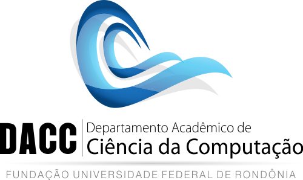

# Minicurso - Backend passo a passo: Criando uma API Geoespacial moderna com Python

Repositório com o material utilizado no minicurso "Backend passo a passo: Criando uma API Geoespacial moderna com 
Python", apresentado na 9ª Semana da Computação - UNIR.

## Material

- [SpatiaLite Cookbook Topics (Version 5.0.0)](https://www.gaia-gis.it/gaia-sins/spatialite-cookbook-5/)
- [aiosqlite: Sqlite for AsyncIO](https://aiosqlite.omnilib.dev/en/stable/index.html)
- [WebSockets - FastAPI](https://fastapi.tiangolo.com/advanced/websockets/)
- [UV - Getting started: Features](https://docs.astral.sh/uv/getting-started/features/)

## Realização

## Licença

Copyright (c) 2026 Gabriel Russo

O uso é fornecido sob a Licença do GNU General Public License v3.0 (GPL-3.0). Veja em LICENSE para mais detalhes.
